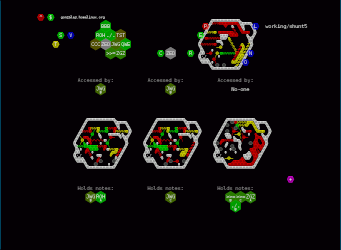
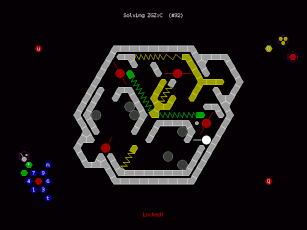
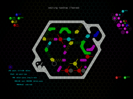
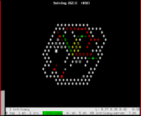

#Intricacy

##About

A game of competitive puzzle-design.

At its core, this is an abstract turn-based puzzle game in which you pick a
lock by co-ordinating a pair of tools to manipulate its mechanism. The locks
you pick are designed by other players; once you have figured out the secret
of how to pick a lock, you must secure that secret behind a lock of your own
devising.

Free software, released under the GPLv3.

Written in Haskell, with SDL and Curses user interfaces.

##Screenshots

##Server address change
The server address has changed from *gonzales.homelinux.org* to
*thegonz.net*. If you have played with an old version (0.2.6.2 or earlier),
you should set the new server address with the '$' command.

##Download

Latest version is 0.3.6 [NEWS](NEWS). If you have the haskell package manager
'cabal' and the SDL dependencies, you can install intricacy from hackage with
<tt>cabal update && cabal install intricacy</tt>. Otherwise, see below.

* Source:
     - ` git clone http://mbays.freeshell.org/intricacy/.git && cd intricacy `
     - or download [source tarball](intricacy-0.3.8.tar.gz)
     - see the [README](README) for compilation instructions
     - please mail me <mbays@sdf.org> if it fails!
* [Windows binary](intricacy-0.3.8-win32.zip)
* [Linux binary](intricacy-0.3.8-linux-i686-glibc-2.16.tgz)
* [Linux binary for older systems](intricacy-0.3.1-linux-i686-glibc-2.14.tgz)
* Arch Linux [PKGBUILD](PKGBUILD) - this is untested, based on something
    generated by [cblrepo](https://github.com/magthe/cblrepo), and may well
    not work. If it does or you know how to make it do so, and you fancy
    putting it on the AUR, that would be great.
* [Old versions](old)

##Introductory video
Download: [47MB ogg theora 15m](intricacy.ogv)

Stream: tell your video player to stream from
    <tt>http://mbays.freeshell.org/intricacy/intricacy.ogv</tt>,
or [use youtube](http://www.youtube.com/watch?v=lmuSNe4bGAM).

##Mailing list
To join the discussion mailing list, please mail
mbays@sdf.org with subject line
'[intricacy-discuss] subscribe'.
